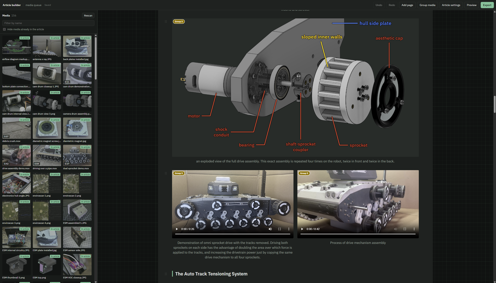
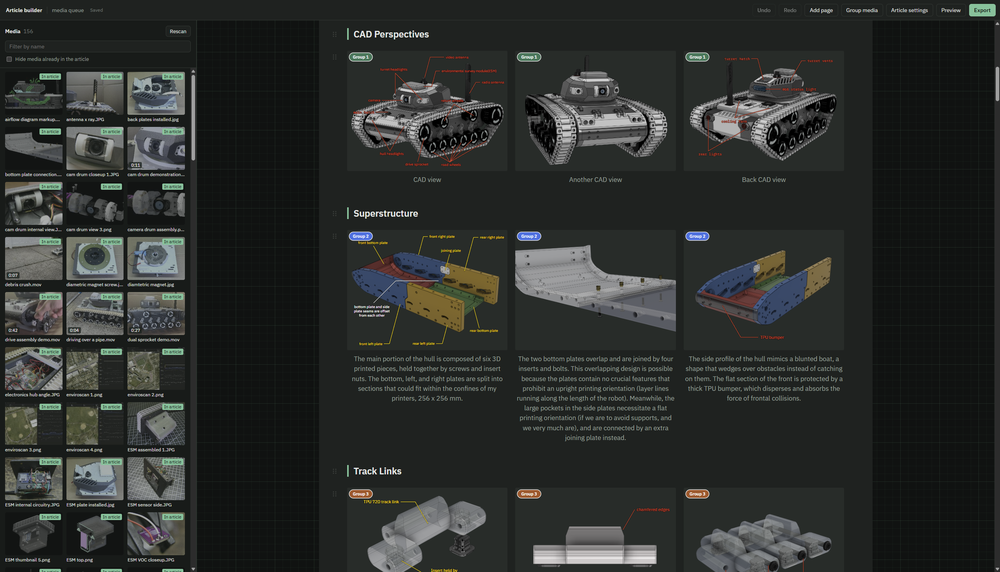

# Article Builder

Turn a folder of photos and videos into a polished project write-up, then export it as a
small static website you can host anywhere.

Article Builder is made for documenting projects: an engineering build, a design process,
a portfolio piece. You lay out the article by dragging your media into rows, write around
it, point things out with labelled lines drawn over your photos, and export plain HTML,
CSS and JavaScript. There is nothing to install, no account, and no server. It's one HTML
file that runs in your browser and works directly on the folder you choose.



## Getting started

1. Download this repository (**Code → Download ZIP**, then unzip it) or clone it.
2. Open `article-builder.html` in **Chrome or Edge on a desktop computer**. Double-clicking
   it is fine; it doesn't need a server.
3. Choose the folder that holds your photos and videos. The browser asks for permission to
   read and write it.
4. Drag media from the panel on the left into the page, and type your text around it.
5. Press **Preview** to see the article as readers will, at desktop or phone width.
6. Press **Export**. The finished site is written to an `export/` folder inside your
   project folder.

To publish, upload the contents of `export/` to any static host, such as GitHub Pages,
Netlify or Cloudflare Pages. The exported site works in any modern browser, including on
phones.

**Why only Chrome or Edge?** The editor reads and writes your folder through the browser's
File System Access API, which Firefox and Safari don't offer. The exported website has no
such limit.

## What it can do



**Layout**
- Rows of one to four columns, with preset column widths or an "equal heights" option that
  lines up pictures of different shapes.
- Section headings, rich text with a choice of four fonts, and captions and alt text on
  every picture and video.
- Several pages per article, each with its own title, linked by buttons at the top and
  bottom of every page.
- Rows can be dragged and reordered, alone or several at a time, and sent to another page.

**Media**
- Photos and videos straight from your folder. Short clips start as silent loops and longer
  ones as players with sound; you can switch either way.
- **Links** instead of files: a YouTube video, or a picture or video hosted elsewhere (for
  example in a Cloudflare R2 bucket). Linked files aren't copied into the export, so large
  videos stay out of your site's folder.
- **Slideshows** for long step-by-step sequences. One cover picture sits in the page and
  opens a full-screen viewer that readers step or swipe through.
- **Image markup**: lines and labels drawn over a photo to point out its parts. The original
  file is never changed.
- **Groups**: pictures you group can be flipped through in the enlarged view.
- Media you don't need can be hidden from the media panel without deleting it.

**The exported site**
- Plain HTML, CSS and JavaScript, with no frameworks and no tracking.
- Pictures and looping clips open enlarged when clicked, and pictures load only as readers
  scroll to them.
- Readable on phones: rows collapse into one or two columns.
- YouTube videos are shown as a still until clicked, then play through YouTube's
  privacy-enhanced player.

**While you work**
- Saves automatically as you type (Ctrl+S saves at once), with undo and redo (Ctrl+Z,
  Ctrl+Y) that remember the last 300 changes.
- Light and dark editor themes.

## Your files

- **Your media is never changed or deleted.** The article is kept in a `project.json` file
  in your folder, next to your media.
- Export only writes inside `export/`. Exporting again copies only what changed and removes
  files the article no longer uses, but only within `export/`.
- Files you drag in from elsewhere on your computer are copied into an `imported/` folder.
- Fonts load from Google Fonts. Without an internet connection the editor still works, with
  your system's fonts standing in.

## Tips

- **Videos:** use MP4 (H.264) for videos that play everywhere. iPhone `.mov` files (HEVC)
  may not play in Chrome; the editor tells you when a video won't play so you can convert
  it.
- **Photos:** iPhone HEIC photos can't be shown by browsers. Export them as JPG first.
- **YouTube plays in the published site, not in the editor.** YouTube's player refuses to
  run in a page opened from your computer, so in the editor and Preview clicking a YouTube
  video opens it on YouTube instead. To check it before publishing, serve the export
  folder locally (for example `python -m http.server` inside `export/`, then open
  `http://localhost:8000`).
- **Renaming a page changes its file name** in the export, so links to the old name stop
  working.

## For developers

There is no build step and no dependencies. The app is plain JavaScript in ordinary
`<script>` files, because a page opened from disk can't load ES modules. They share one
scope, and `article-builder.html` lists them in load order.

```
article-builder.html   the editor page
css/editor.css         the editor's styles
js/                    the editor, plus the exported page's CSS and script (js/template.js)
test/                  automated tests that drive the real app in headless Chrome
NOTES.md               how everything works, file formats, what is tested, known limits
```

Run the tests with **Node 22 or newer** and **Chrome** installed:

```
node test/all.mjs          every suite, with totals
node test/markup.mjs       one suite, listing every check
```

Set `CHROME_PATH` if Chrome isn't in its usual place. Read [NOTES.md](NOTES.md) before
changing things: it explains the structure, the `project.json` and export formats, and
the pitfalls that tests have caught.
